# Architecture Specification: CTBF-AI-05 (Module 1)
## Resume Screening, ATS Matching & Synthetic Candidate Ranking

---

### 1. Executive Summary & Context
**Project:** CTBF-AI-05 – Resume–Job Matching and Skill-Gap Coach for Tier-2 Graduates  
**Track:** AI & Intelligent Systems | **Category:** Software | **Theme:** Skill Development & Employability  
**Scope:** **Module 1 – Resume Screening and ATS Matching Backend**.

Module 1 provides a production-grade, explainable, and deterministic Python/FastAPI backend that:
1. Ingests candidate resumes in **PDF**, **DOCX**, and **JSON** formats.
2. Ingests job descriptions (JD) in **text** or **structured JSON**.
3. Performs robust extraction with explicit evidence snippets and provenance tracking.
4. Calculates a **deterministic, explainable 0–100 ATS match score** with configurable weights across 7 categories.
5. Verifies **mandatory job requirements** strictly separated from numerical scoring (`met`, `not_met`, `unverified`).
6. Generates **exactly 100 unique, job-specific synthetic candidate profiles** across 7 competency bands using Groq LLM.
7. Benchmarks the actual candidate against all 100 synthetic profiles using the **identical scoring engine**, yielding fair percentiles, ranks, and distributions.
8. Persists all structured data and sessions into **Supabase PostgreSQL**.
9. Exposes standardized JSON contracts consumable by **Modules 2–5** (Skill Gap Analysis, Course Recommendations, AI Mock Interview, and 30-Day Improvement Plan).

---

### 2. High-Level System Architecture

```mermaid
flowchart TD
    subgraph Client/External
        A[Resume: PDF / DOCX / JSON] -->|Upload / Parse| API[FastAPI Endpoints /api/v1/screening]
        B[Job Description: Text / JSON] -->|Submit / Parse| API
    end

    subgraph "Core Ingestion & Extraction"
        API --> P_ROUTER{Format Router}
        P_ROUTER -->|PDF| P_PDF[PyMuPDF Parser + OCR Fallback]
        P_ROUTER -->|DOCX| P_DOCX[python-docx Parser]
        P_ROUTER -->|JSON| P_JSON[JSON Validator]
        
        P_PDF --> EXT_NORM[Text Normalizer & Section Segmenter]
        P_DOCX --> EXT_NORM
        P_JSON --> EXT_NORM
        
        EXT_NORM --> LLM_EXT[Groq AI Structured Extractor]
        LLM_EXT --> EVI_VAL[Evidence & Confidence Validator]
    end

    subgraph "ATS Matching Engine (Deterministic)"
        EVI_VAL --> MATCHER[ATS Evaluation Engine]
        B_EXT[Job Extractor] --> MATCHER
        
        MATCHER --> S_SKILL[Skills Matcher (35% Req / 15% Pref)]
        MATCHER --> S_EXP[Experience Matcher (15%)]
        MATCHER --> S_PROJ[Project Matcher (15%)]
        MATCHER --> S_EDU[Education Matcher (10%)]
        MATCHER --> S_CERT[Certification Matcher (5%)]
        MATCHER --> S_ROLE[Role Relevance Matcher (5%)]
        MATCHER --> S_MAND[Mandatory Requirement Verifier]
        
        S_SKILL & S_EXP & S_PROJ & S_EDU & S_CERT & S_ROLE --> ATS_CALC[Deterministic Score Calculator (0-100)]
    end

    subgraph "Synthetic Candidate Benchmarking"
        B_EXT --> SYN_GEN[Groq 100 Synthetic Generator]
        SYN_GEN -->|10 Batches x 7 Bands| SYN_VAL[Diversity & Schema Validator]
        SYN_VAL --> SYN_SCORED[Deterministic ATS Scorer for 100 Personas]
        SYN_SCORED & ATS_CALC --> RANK_ENG[Rank & Percentile Calculator]
    end

    subgraph "Persistence & Inter-Module Bus"
        ATS_CALC --> SUPABASE[(Supabase PostgreSQL)]
        SYN_SCORED --> SUPABASE
        RANK_ENG --> SUPABASE
        
        API -->|JSON Contract| M2[Module 2: Skill Gap Analysis]
        API -->|JSON Contract| M3[Module 3: Course Recommendations]
        API -->|JSON Contract| M4[Module 4: AI Mock Interview]
        API -->|JSON Contract| M5[Module 5: 30-Day Plan]
    end
```

---

### 3. Detailed Component Breakdown

#### 3.1. Parsing & Extraction Pipeline
- **PDF Extraction:** Extracts digital text using `PyMuPDF` (`fitz`). If extracted text density is below threshold (< 50 characters or scanned pages), invokes fallback OCR.
- **DOCX Extraction:** Parses XML paragraphs, tables, and headers with `python-docx`.
- **Text Normalization:** Standardizes unicode characters, whitespace, removes headers/footers, and segments sections (Summary, Skills, Experience, Education, Projects, Certifications).
- **Structured Extraction:** Utilizes Groq LLM (`llama-3.3-70b-versatile`) with strict JSON schema enforcement to output candidate profiles with field-level evidence snippets. Every extracted entity tracks:
  - `value`: Normalized representation.
  - `evidence_snippet`: Exact text from resume.
  - `source_section`: Section identified.
  - `confidence`: Heuristic/extraction confidence (0.0 to 1.0).
  - `status`: `explicit` | `inferred` | `not_found` | `requires_verification`.

#### 3.2. ATS Matching Engine & Formula
The ATS engine is **100% deterministic Python logic**. Groq is never allowed to directly generate the numerical match score.
Configurable weights (default summing to 100%):
1. **Required Skills & Keywords (35%)**: Exact matches (1.0), verified aliases/equivalents (0.85), related skills (0.4), missing (0.0).
2. **Preferred Skills (15%)**: Bonus points for nice-to-have capabilities.
3. **Relevant Experience (15%)**: Evaluated using non-overlapping employment date ranges. Freshers/graduates are not penalized if the JD does not require professional experience.
4. **Projects & Practical Experience (15%)**: Evaluated based on technology stack alignment, complexity, and concrete outcomes.
5. **Education & Qualifications (10%)**: Degree level and major alignment without bias towards college prestige/tier.
6. **Certifications (5%)**: Relevant professional certifications present.
7. **Job-Title & Role Relevance (5%)**: Semantic overlap between candidate background/summary and target role.

#### 3.3. Mandatory Requirement Verification
Executed as an independent verification gate:
- Status: `MET`, `NOT_MET`, or `UNVERIFIED`.
- If an item is unmentioned in the resume, it is tagged `UNVERIFIED` rather than auto-rejected.

#### 3.4. Synthetic Candidate Pool & Percentile Formula
- **100 Profiles Generated:** Across 7 strict competency bands:
  - Very High: 10
  - High: 20
  - Upper-Middle: 20
  - Middle: 20
  - Lower-Middle: 15
  - Low: 10
  - Very Low: 5
- **Scored Identically:** Every synthetic candidate is converted to the canonical candidate schema and evaluated by the exact same ATS engine and weights.
- **Percentile Calculation:**
  $$\text{Percentile} = \left(\frac{\text{Synthetic Candidates with Score} < \text{Candidate Score}}{100}\right) \times 100$$
- Ties are accounted for separately and reported transparently.

---

### 4. Database Schema (Supabase PostgreSQL)

```mermaid
erDiagram
    RESUMES ||--o{ RESUME_EXTRACTIONS : has
    JOBS ||--o{ JOB_REQUIREMENTS : has
    SCREENING_SESSIONS ||--|| RESUMES : references
    SCREENING_SESSIONS ||--|| JOBS : references
    SCREENING_SESSIONS ||--o{ SCREENING_SCORE_BREAKDOWNS : produces
    SCREENING_SESSIONS ||--o{ SYNTHETIC_PERSONAS : generates
    SCREENING_SESSIONS ||--|| CANDIDATE_RANKINGS : concludes

    RESUMES {
        uuid id PK
        uuid user_id
        string file_name
        string file_type
        int file_size
        string file_url
        text raw_text
        timestamp created_at
    }

    RESUME_EXTRACTIONS {
        uuid id PK
        uuid resume_id FK
        jsonb candidate_info
        jsonb education
        jsonb skills
        jsonb experience
        jsonb projects
        jsonb certifications
        jsonb extraction_metadata
        timestamp created_at
    }

    JOBS {
        uuid id PK
        string title
        string company
        string seniority
        int min_experience_years
        text raw_text
        jsonb structured_data
        timestamp created_at
    }

    SCREENING_SESSIONS {
        uuid id PK
        uuid user_id
        uuid resume_id FK
        uuid job_id FK
        string status
        float ats_score
        string mandatory_status
        jsonb scoring_config
        timestamp created_at
        timestamp completed_at
    }

    SYNTHETIC_PERSONAS {
        uuid id PK
        uuid session_id FK
        uuid job_id FK
        string band
        jsonb profile_data
        float ats_score
        timestamp created_at
    }

    CANDIDATE_RANKINGS {
        uuid id PK
        uuid session_id FK
        float actual_score
        int rank
        int total_compared
        int synthetic_above
        int synthetic_below
        int synthetic_tied
        float percentile
        jsonb score_distribution
        timestamp created_at
    }
```



---

### 5. Standardized Cross-Module JSON Contract

All API endpoints wrap data in the standardized schema:
```json
{
  "schema_version": "1.0",
  "user_id": "3fa85f64-5717-4562-b3fc-2c963f66afa6",
  "resume_id": "3fa85f64-5717-4562-b3fc-2c963f66afa6",
  "job_id": "3fa85f64-5717-4562-b3fc-2c963f66afa6",
  "session_id": "3fa85f64-5717-4562-b3fc-2c963f66afa6",
  "module": "resume_screening",
  "status": "completed",
  "data": { ... },
  "created_at": "2026-10-30T10:00:00Z"
}
```

Specific inter-module output endpoints:
- `GET /api/v1/screening/{session_id}/skill-gap-input` (for Module 2)
- `GET /api/v1/screening/{session_id}/course-input` (for Module 3)
- `GET /api/v1/screening/{session_id}/interview-input` (for Module 4)
- `GET /api/v1/screening/{session_id}/improvement-plan-input` (for Module 5)

---

### 6. Implementation Roadmap
- **Phase 1:** Core setup, configuration, database connectivity, domain models, Pydantic schemas.
- **Phase 2:** Multi-format parser engine (PDF, DOCX, JSON, text) + structured Groq extraction with evidence tracking.
- **Phase 3:** Job description parser & requirement classifier.
- **Phase 4:** Deterministic ATS scoring engine & mandatory requirements verifier.
- **Phase 5:** 100-synthetic candidate generation engine with band balancing & validation.
- **Phase 6:** Ranking, percentile calculation, and score distribution analytics.
- **Phase 7:** FastAPI routes, session coordinator, background task executor, and integration endpoints.
- **Phase 8:** Unit & integration test suites, evaluation runner, security guards, and documentation.
